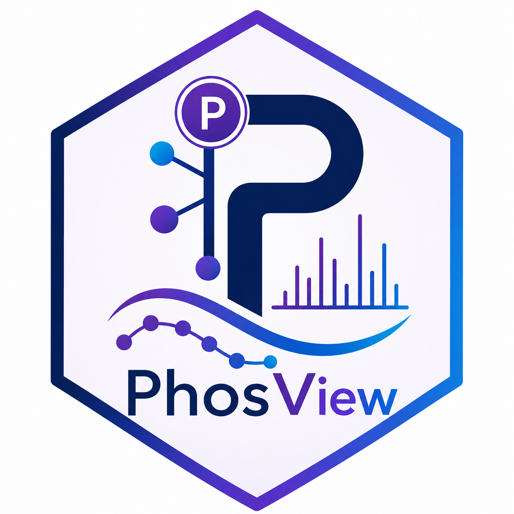

# PhosView

<!-- badges: start -->
[](https://github.com/OMICShub-Imagine/PhosView)
[](https://www.gnu.org/licenses/gpl-3.0)
<!-- badges: end -->

**An Integrated and Interactive Tool for Quantitative Proteomics and Phosphoproteomics Analysis**

PhosView is a golem/Shiny R package for sequential proteome and phosphoproteome analysis 
with localization-probability QC, dual-view integration, ORA, PhosR kinase-substrate scoring 
and Pathview maps.

# PhosView Overview


## Disclaimer

PhosView has been developed and tested internally on small datasets
at the Proteomic Platform of the SFR Necker. As it is still in version 1.0.0, updates will
be published as issues are identified and resolved.

Bug reports, feature requests, and feedback are welcome:
**[Open an issue](https://github.com/OMICShub-Imagine/PhosView/issues)**

*PhosView is a free R package and comes with ABSOLUTELY NO WARRANTY.*

## Quick Start

You can install the version 1.0.0 of `{PhosView}` like so:

### Installation

#### 1. Prerequisites

PhosView requires **R >= 4.1.0** (https://cran.r-project.org/bin/windows/base/) and RStudio (but is not mandatory)

#### 2. Install

```r
if (!require("remotes")) install.packages("remotes")

remotes::install_github("OMICShub-Imagine/PhosView")
```

### Run

You can launch the application by running:

``` r
library(PhosView)
PhosView::run_app()
```

## Input files

If DIA-NN was used to process the phospho-enriched samples and associated non-enriched samples:

- report.pg_matrix.tsv (and associated exp_design.txt)
- report.phosphosite_90.tsv or report.phosphosite_99.tsv (and associated exp_design.txt)
- Example input files are present in https://github.com/OMICShub-Imagine/PhosView/tree/main/inst/extdata/dia-nn

If Spectronaut was used to process the phospho-enriched samples and associated non-enriched samples:

- Use the schema specific to Spectronaut software available in https://github.com/OMICShub-Imagine/PhosView/tree/main/inst/extdata/schema_spectronaut.
- These schema can be loaded on Spectronaut software and allows to have exactly the required columns that need to be present in input files.
- Also, example input files are present in https://github.com/OMICShub-Imagine/PhosView/tree/main/inst/extdata/spectronaut

More details about experimental file (exp_design.txt):

| Column | Required | Description |
|--------|----------|-------------|
| `Sample_ID` | Yes | Quantitative column name present in input files (only quant columns) |
| `Simplify_ID` | Yes | Shorter name of Sample_ID (avoid any special character and used _ as separator (CTRL_01, KO_01...)) |
| `group` | Yes | Biological group (CTRL, KO...) |


## Key Features

- Sequentially preprocesses and tests based on proteoDA workflow.
- Quality control reports at each step of the analysis.
- Phosphosite quality control report.
- Dual-view explorer.
- clusterProfiler-based ORA (**available taxonomy: *Homo sapiens* and *Mus musculus***).
- PhosR kinase-substrate inference (**PhosphoSitePlus annotation snapshot not been updated for several years**)
- Pathview KEGG maps.
- Quality control reports at each step of the analysis.

## Tutorials

[How to use PhosView?](https://htmlpreview.github.io/?https://github.com/OMICShub-Imagine/PhosView/blob/main/docs/index.html)


```r
library(PhosView)
```

## Citation

If you use PhosView in your research, please cite:

> Roger K, Ceccacci S, Guerrera C, Puig Lombardi ME (2026).
> *PhosView : An Integrated and Interactive Tool for Quantitative Proteomics and Phosphoproteomics Analysis.*
> R package version 1.0.0. Institut Imagine, Paris, France.

```r
citation("PhosView")
```

### Please also cite the underlying tools

PhosView wraps several published methods. 

| Tool | Citation |
|------|----------|
| **proteoDA** | Thurman TJ, Washam CL, Alkam D, Bird JT, Gies A, Dhusia K, et al. **proteoDA: a package for quantitative proteomics.** Journal of Open Source Software. 30 mai 2023;8(85):5184. [doi:10.21105/joss.05184](https://doi.org/10.21105/joss.05184) |
| **clusterProfiler** | Wu T, Hu E, Xu S, Chen M, Guo P, Dai Z, et al. **clusterProfiler 4.0: A universal enrichment tool for interpreting omics data.** The Innovation. août 2021;2(3):100141. [doi:10.1016/j.xinn.2021.100141](https://doi.org/10.1016/j.xinn.2021.100141) |
| **PhosR** | Kim HJ, Kim T, Xiao D, Yang P. **Protocol for the processing and downstream analysis of phosphoproteomic data with PhosR.** STAR Protocols. juin 2021;2(2):100585. [doi:10.1016/j.xpro.2021.100585](https://doi.org/10.1016/j.xpro.2021.100585) |
| **Pathview** | Luo W, Brouwer C. **Pathview: an R/Bioconductor package for pathway-based data integration and visualization.** Bioinformatics. 15 juill 2013;29(14):1830‑1. [doi:10.1093/bioinformatics/btt285](https://doi.org/10.1093/bioinformatics/btt285) |


## Authors

- **Kévin Roger** — Author, maintainer | Proteomics platform Necker, Université Paris Cité - Structure Fédérative de Recherche Necker, INSERM US24/CNRS UAR3633, Paris, France | Bioinformatics Core, SFR Necker – Institut Imagine, INSERM U1163, Paris, France 
- **Sara Ceccacci** — Contributor | Proteomics platform Necker, Université Paris Cité - Structure Fédérative de Recherche Necker, INSERM US24/CNRS UAR3633, Paris, France
- **Chiara Ida Guerrera** — Supervisor | Proteomics platform Necker, Université Paris Cité - Structure Fédérative de Recherche Necker, INSERM US24/CNRS UAR3633, Paris, France
- **Maria Emilia Puig Lombardi** — Supervisor | Bioinformatics Core, SFR Necker – Institut Imagine, INSERM U1163, Paris, France

## License

GPL (>= 3)

