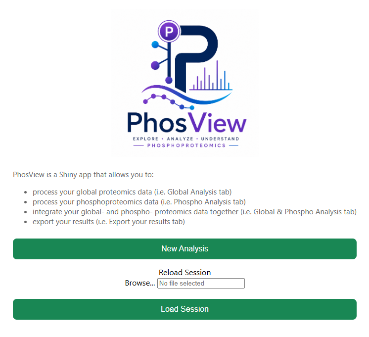

## Starting material {#sec-start_material}

After you install the PhosView R package, you will need to get different input files.

PhosView allows to use different kind of input from 2 softwares (regarding the one that you choose to run your analysis):

### DIA-NN Academia (version >=2.5)

I work on the assumption that users know how to run a label free global analysis and a phospho-proteomics analysis on DIA-NN with the proper settings.

  + report.pg_matrix.tsv file exported from DIA-NN. This file corresponds to the quant table of your global experiment (non phopho-enriched samples).
  + report.phosphosites_90.tsv or report.phosphosites_99.tsv files exported from DIA-NN. This file corresponds to the quant table of your phospho experiment (phospho-enriched samples).


### Spectronaut (version >=19)

I work on the assumption that users know how to run a label free global analysis and a phospho-proteomics analysis on Spectronaut with the proper settings. This is pretty straightforward in Spectronaut by clicking on "Set up directDIA Analysis from Folder" and use the "BGS Factor Settings (default)" to run the global analysis and the "BGS Phospho PTM workflow" to run the phosphoproteomics analysis.

  + report file exported from Spectronaut using the PhosView_Global.rs schema (present in inst/extdata) that you can import in the Report tab in Spectronaut. This file corresponds to the quant table of your global experiment (non phospho-enriched samples).
  + report file exported from Spectronaut using the PhosView_Phospho.rs schema (present in inst/extdata) that you can import in the Report tab in Spectronaut. This file corresponds to the quant table of your phospho experiment (phospho-enriched samples).
  
### Run PhosView

```r
library(PhosView)
run_app()
```
  
## Landing page {#sec-landing_page}

After executing the command `run_app()`, the app will open and a landing page will appear on your screen (see below).



You will have two possibilities:

  + Click on "New analysis" if you run to run an analysis from scratch (next sections will detail this part).
  + Click on "Load Session" if you want to reload your previous session by using a specific R object (I will come back later into that part in the {#sec-reload-session}).

Now let's start with a New Analysis by clicking on the "New Analysis" button !
