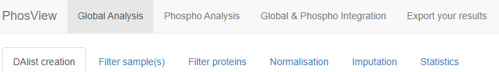
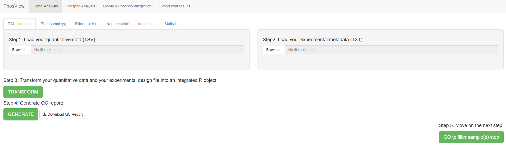
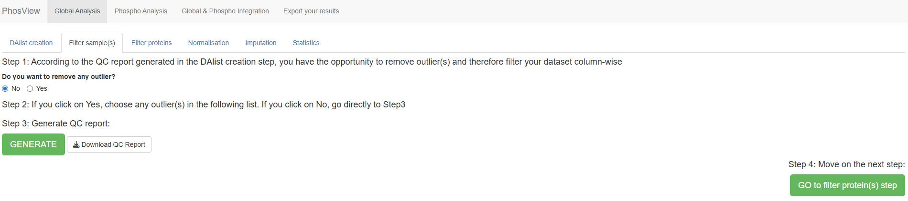
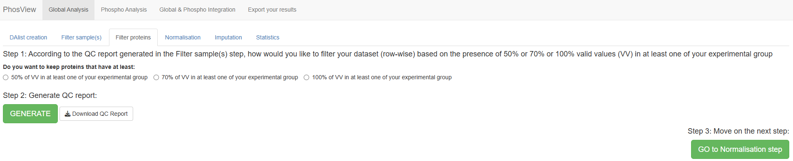
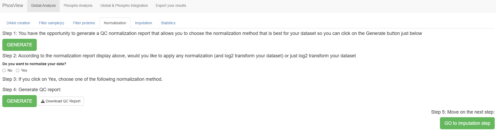
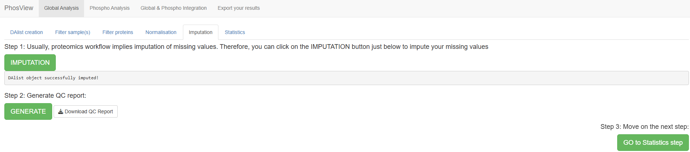
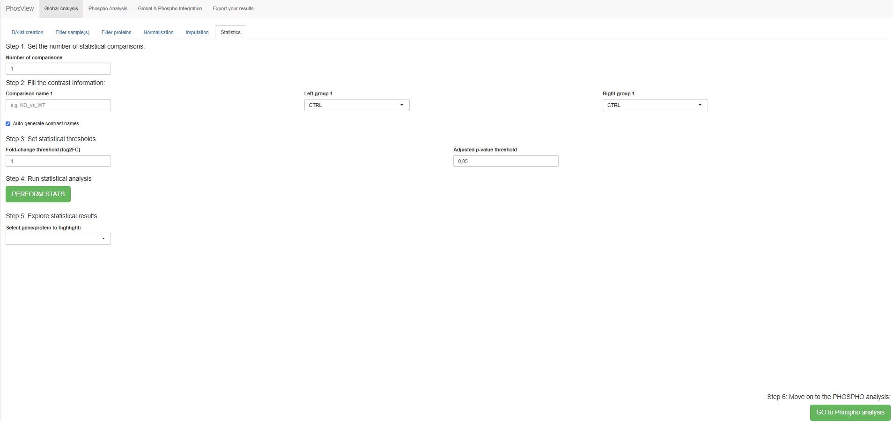

## Global analysis {#sec-glob_analysis}

After clicking on the "New analysis" button, you will land in the "Global Analysis" main tab that contain 6 subtabs (see below).

Each subtab correspond to different preprocessing steps that you will need to perform sequentially.
All these preprocessing step uses the proteoDA R package [@proteoDA]

### DAlist creation

#### Step1 & Step2

This step corresponds to data import/loading. You will need to import your quantitative data from the global analysis (the one that you export from the software (see [Starting material](#sec-start_material)). Then, you will need to upload a experimental design file. This file is just a txt file that need to have the **exact following column names**:

  + **Sample_ID**
  + **Simplify_ID**
  + **group**

**Sample_ID** corresponds the the column name of your quantitative columns.
**Simplify_ID** is a shorter name that you can create (avoid spaces or special characters and I recommend always to start with a letter and to use the _ as a separator). Some good examples would be CTRL_01 or KO_02. Somme wrong example would be 01-CTRL or
**group** corresponds to your experimental design.

#### Step3

Step3 allows to transform your quantitative matrix loaded in *Step1* and your experimental design file loaded in *Step2* into an integrated R object called **DAList** [@proteoDA]. Therefore, you need to click on the TRANSFORM button.

#### Step4

Step 4 allows you to generate of interactive and integrated QC report of your data in order to investigate the quality of the data that you have generated. Note that you will be able to generate this kind of QC report at each preprocessing step in order to check the impact of the preprocessing step on your data (e.g. filtering, removal of a potential outlier, normalisation...) but this is not mandatory to continue to the next steps. I always recommend you to click on the GENERATE button. 

**Important Note**: You can also download your QC report by clicking on the dedicated button in order to export a interactive Quarto report. Be aware that this process can take time (more or less 30 seconds depending on the size of your dataset) so I advice to be patient and avoid clicking several time on the button.

#### Step5

When you are finished to investigate your QC report, you can click on the Go to the filter sample(s) step button.

### Filter sample(s)

#### Step1

According to the previous QC report generated in the DAList creation subtab, it is possible (or not) that you spot a sample having an unexpected behavior. Therefore you can choose the remove or not any outlier(s) that you want by clicking on No or Yes.

#### Step2

  + If you click on Yes, you can choose the outlier by clicking on the Simplify_ID in the dropdown menu and click on the REMOVE button.
  + If you click on No, nothing else is to be done.
  
#### Step3

You can still click on the GENERATE button to check the impact of removing any outliers but if you did not remove any outlier(s), the QC report will remain the same as the one from the DAList creation subtab.
  
#### Step4

When you are finished to investigate your QC report, you can click on the Go to the filter protein(s) step button.

### Filter protein(s)

#### Step1

According to the previous QC report generated in the DAList creation subtab, it is possible to filter proteins based on their number of *valid values* (VV) (i.e quantitative values extracted from your MS spectra) in at least one of your experimental group in order to not rely on proteins that have too many missing values.

**Important Note**: As protein that we called ON/OFF (present totally or in a few replicates in one experimental condition and completely absent in the other condition) can be interesting for the biology, PhosView only allowed to filter for a specific % of valid values (50, 70 or 100) **in at least one of your experimental group**.

After choosing the threshold that you want, you can click on the KEEP button.

#### Step2

As previously mentioned, you can click on the GENERATE button to check the impact of the filter that you have just applied at the protein-level.

#### Step3

When you are finished to investigate your QC report, you can click on the Go to the Normalisation step button.

### Normalization

#### Step1

During the Step 1, you have the opportunity to generate a QC normalisation report in order to choose the best way to normalize your data by clicking on the GENERATE button. 

In a nutshell, it will generate QC plots after applying each normalisation method (log2, median, mean, vsn, quantile, cycloess, rlr gi) proposed by the proteoDA package in order to check specific statistical metrics (PCV, PMAD, PEV, COR) for each normalization.

This report is coming from the proteoDA R package so if you want to know more about it, I recommend you to visit https://github.com/ByrumLab/proteoDA and more specifically read the proteiNorm paper [@proteiNorm].

#### Step2

Step2 allows you to choose or not a specific normalization methods.

  + If you click on No, you will be force to click on *no normalisation followed by log2 normalisation* and click on the NORMALIZATION button

#### Step3

  + If you click on Yes, you can choose the normalization methods of your choice followed by log2 transformation of your data by clicking on the NORMALIZATION button.

#### Step4

As previously mentioned, you can click on the GENERATE button to check the impact of the normalization that you have just applied at the protein-level.

#### Step5

When you are finished to investigate your QC report, you can click on the Go to the imputation step button.

### Imputation

#### Step1

Usually, proteomics workflow implies imputation of missing values. We only propose one imputation method that corresponds to filling missing data points by creating a Gaussian distribution of random numbers with a standard deviation of 30% relative to the standard deviation of the measured values and 1.8 standard deviation downshift of the mean to simulate the distribution of low signal values.

You can perform this imputation by clicking on the IMPUTATION button. 

#### Step2

As previously mentioned, you can click on the GENERATE button to check the impact of the imputation that you have just applied at the protein-level.

#### Step3

When you are finished to investigate your QC report, you can click on the Go to the Statistics step button.

### Statistics

#### Step1

This step allows you to set the number of statistical comparison that you want to investigate.

Changing the number will impact the number of rows (comparison) in Step 2.

#### Step2

Step2 allow you to fill the contrast information by choosing the experimental groups.

#### Step3

Step3 allows you the set the log2FC threshold and the adjusted p-value threshold to control for False Discovery Rate (FDR). Usually in proteomics, we choose FDR 5 % (0.05)

#### Step4

When every parameters are set, we can click on the PERFORM STATS button

#### Step5

Finally, you can explore the volcano plot of your global analysis by selecting the statistical comparison of interest and also select a spcific gene to highligh in the volcano plot and investigate the associated profile plot on the right of the volcano plot.

#### Step6

When the global analysis is finished, it is time to perform the phospho analysis on the phospho enriched sample by clinking on the Go to the Phospho analysis button.

