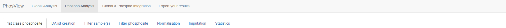
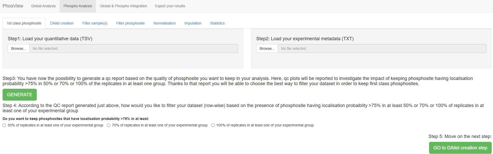

## Phospho analysis

After clicking on the Go to the Phospho analysis button, you will land in the "Phospho analysis" main tab that contain 7 subtabs (see below).

Each subtab correspond to different preprocessing steps that you will need to perform sequentially.

Intead of the first preprocessing step called *1st class phosphosite*, all the remaining preprocessing step uses the proteoDA R package [@proteoDA] and are exactly **identical to the one of the global analysis**. Therefore, it will not be detailed again, please refer to the [Global Analysis](#sec-glob_analysis) section. The only difference is that in the *Global Analysis* the features were proteins whereas in the *Phospho Analysis*, the features are phosphosites.

### 1st class phosphosite

#### Step1 & Step2

This step corresponds to data import/loading. You will need to import your quantitative data from the phospho analysis (the one that you export from the software (see [Starting material](#sec-start_material)). Then, you will need to upload a experimental design file. This file is just a txt file that need to have the **exact following column names**:

  + **Sample_ID**
  + **Simplify_ID**
  + **group**

**Sample_ID** corresponds the the column name of your quantitative columns.
**Simplify_ID** is a shorter name that you can create (avoid spaces or special characters and I recommend always to start with a letter and to use the _ as a separator). Some good examples would be CTRL_01 or KO_02. Somme wrong example would be 01-CTRL or
**group** corresponds to your experimental design.

#### Step3

Step3 allows to generate a QC report that will allows you to choose the best filter in order to get 1st class phosphosite before transform it to a DAList object.

**Important Note**: Indeed, we used to run the phospho analysis on Spectronaut with localisation probability threshold equal to 0 in the setting instead of 0.75 and we prefer to filter for the localisation probability manually afterwards in the PhosView app.

Therefore, you need to click on the GENERATE button in order to build this QC report.

#### Step4

According to the previous QC report generated in Step3, it is possible to filter phosphosite in order to only keep phosphosites that have a localisation probability >75% in at lease 50% or 70% or 100% of replicated in at least on e of your experimental group.

**Important Note**: Indeed, in your quantitative matrix you have as many quantitative columns (one for each sample) as localisation probability columns (one for each sample) so you can applied the same kind of filtering that you usually apply at the protein level (valid values) but here you apply this filter for the presence of a localisation probability that need to be higher than 75%.

After choosing the threshold that you want, you can click on the KEEP button.

#### Step5

When you are finished with this preprocessing step, you can click on the Go to the DAList creation step button.

### All remaining preprocessing step

All the remaining preprocessing step from *DAlist creation* to *Statistics* are based on the same function and principle than for the Global Analysis and they rely also on the use of the proteoDA R package [@proteoDA].

Therefore, I suggest you to refer to the [Global Analysis](#sec-glob_analysis) section.

At the end of the *Statistics* tab, we will need to click on the Go to the INTEGRATION analysis button in order to integration and explore both analysis side by side.
