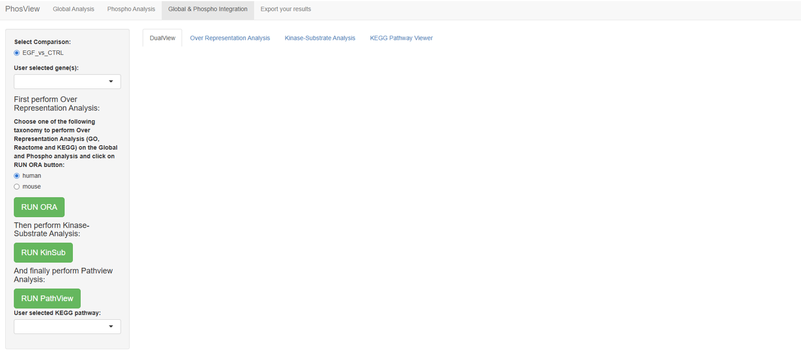
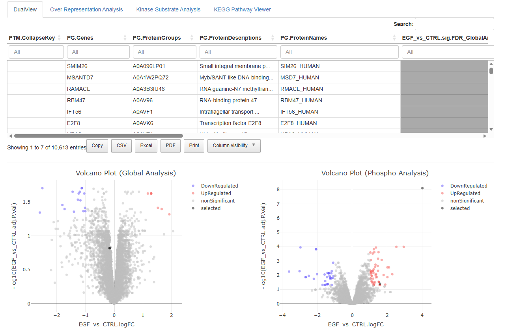
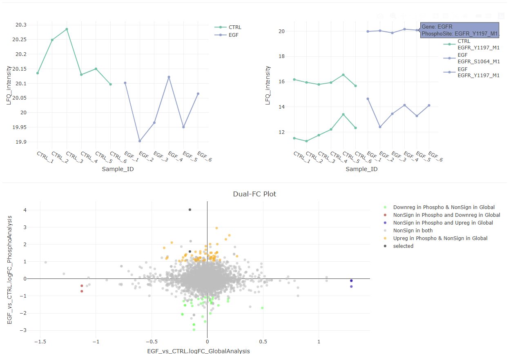
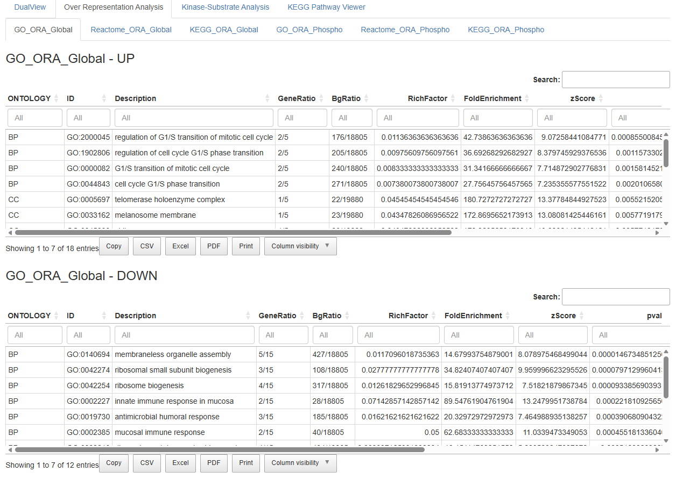
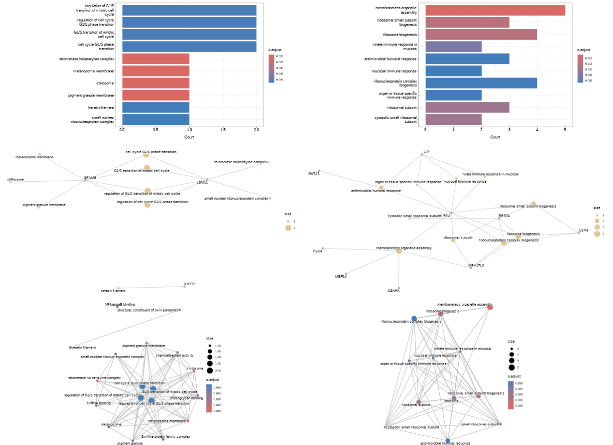
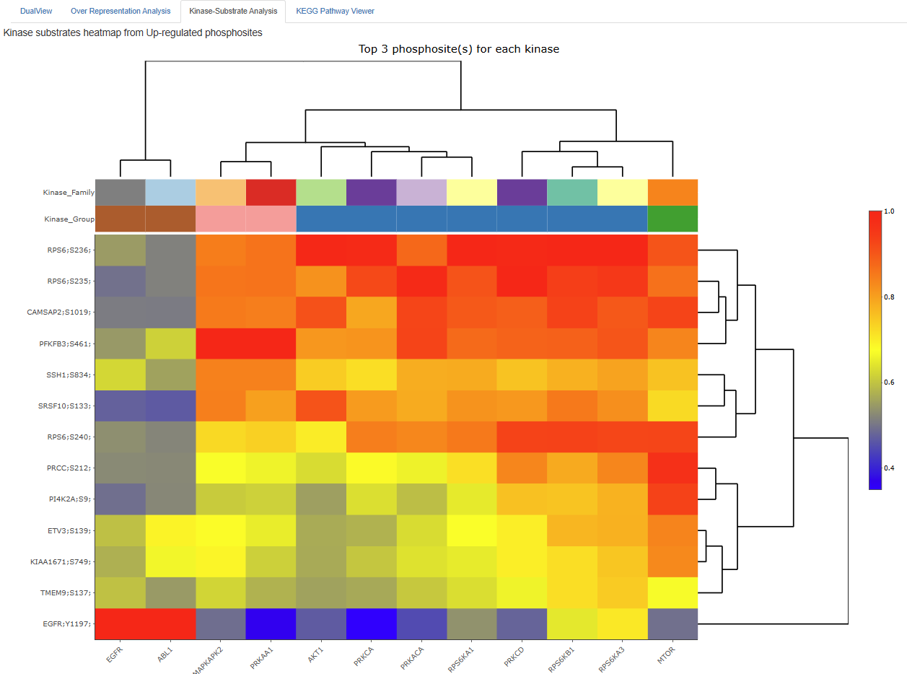
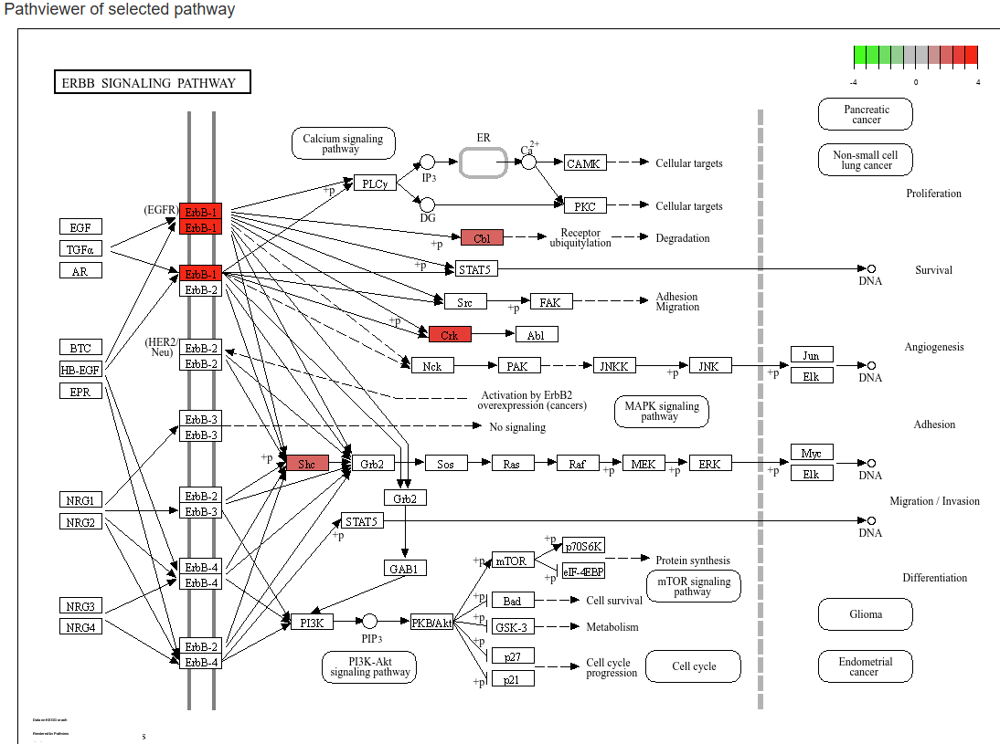

## Global & Phospho Integration

The Global & Phospho Integration contain 4 main modules:

  + **DualView** based on the use of the tidyverse
  + **Over Representation Analysis** based on the use of the clusterProfiler R package [@clusterProfiler].
  + **Kinase-Substrate Analysis** based on the use of the PhosR R package [@phosR].
  + **KEGG Pathway Viewer** based on the use of the Pathview R package [@pathview].

You can notice also that you now have a sidebar of the left. This sidebar allows you to do several thing:

  + Select the statistical comparison of interest that will modify and update the rendering of all the 4 main modules cited above.
  + Select a specific protein by using its associated gene name.
  + Perform the Over Representation analysis after (or even during) you investigate the DualView results (more on that in the next part)
  + Perform the Kinase Substrate Analysis
  + Perform the Pathview analysis
  
**Important Note**: When you land on this *DualView* module, I recommend that you choose the taxonomy of your study (for the moment only 2 available: human or mouse) and perform the Over Representation Analysis by clicking on the RUN ORA button. A progress bar will appear at the bottom right of your screen. I recommend to wait that the analysis is finished before running the next Kinase-Substrate analysis by clicking on the RUN KinSub button. In the same way, wait that the analysis is performed (cf progress bar) to run the final Pathview Analysis by clicking on the RUN PathView button.

### Dual View

The DualView module allows you to investigate the statistical results using the statistical table with volcano plot side by side (left: global, right: phospho). It is also possible to look for a specific gene and investigate the corresponding profile plot with associated phosphosites (if present). At the bottom, a dual fold change plot is present summarizing the log2FC of the protein that have corresponding phosphosite. The color code is here to know if a protein and/or corresponding phosphosite is significantly (or not) up/down - regulated in the statistical analysis.

One example of layout below:

### Over Representation Analysis

Over Representation Analysis will be perform on the significant up- and down- regulated protein (for the global analysis) and phosphosite (for the phospho analysis) of each statistical comparison using the GO (Gene Ontology), Reactome and KEGG annotations embedded with the clusterProfiler R package.

Therefore, after clicking on the RUN ORA button and wait that the analysis is finished to run, it will generate 6 subtab inside the Over Representation Analysis tab:

  + GO_ORA_Global
  + Reatome_ORA_Global
  + KEGG_ORA_Global
  + GO_ORA_Phospho
  + Reatome_ORA_Phospho
  + KEGG_ORA_Phospho
  
Each of those subtabs will contain the enrichment results for the up- and down regulated features (protein or phosphosite) and associated plots (barplot, cnetplot, emapplot) that is possible to make usually with clusterProfiler/enrichplot R packages.

One example of layout below:

### Kinase-Substrate Analysis

The Kinase-Substrate Analysis will be perform on the up- and down- regulated phosphosites for each statistical comparison and will generate an heatmap of substrate scores for kinases that pass filtering based on both motifs and dynamic profiles (https://pyanglab.github.io/PhosR/index.html). The highest the score is, the highest the reliability of a phosphosite is a substrate of a specific kinase is.

One example of layout below:

### KEGG Pathway Viewer

The KEGG pathway viewer module is performing an Over Representation Analysis using the kinase found in the kinase-substrate score matrix (PhosR) and the gene associated to the up- and down- regulated phosphosites from the statistical analysis.

Then the list of KEGG pathway enriched is retrieve and rendered using PathView R package and the kinase found in the kinase-substrate score matrix and the gene associated to the up- and down- regulated phosphosites from the statistical analysis are colored using their respective log2FC values.

One example of layout below:

At the end of the *Global & Phospho Integration* tab, we will need to click on the Go to EXPORTS button in order to save some results table and more importantly save your session if you would like to come back to your results later. 

**Important Note**: In order to reload your session, you will need to rerun PhosView (`run_app()` function). You will come back to the landing page introduce in the [Landing page](##sec-landing_page) section. This time, do not click in *New Analysis* but instead click on the **Browser**, look for your session file and click on the Load Session button. Be aware that doing so, you will only have access to the content of *Global and Phospho Integration* main tab.
