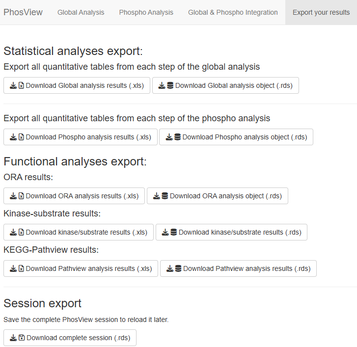

## Export your results

If you arrive at the step, it means that you have successfully finish to analyze your data (or at least the first exploration).

On the tab, you will have the opportunity to download different kind of files:

  + The quantitative matrix and statistics results from your *Global Analysis* in .xls format and .rds format
  + The quantitative matrix and statistics results from your *Phospho Analysis* in .xls format and .rds format
  + All the functional analyses export of the ORA, Kinase-substrate and KEGG pathview analysis in .xls format and .rds format
  + Finally, you can also export your session in rds. format that can be reload in the landing page
  
**Important Note**: The .xls file could be used as a supplementary file for article submission. The .rds file are R specific object that you could use to investigate in more depth your results or even create more publication ready figures.

